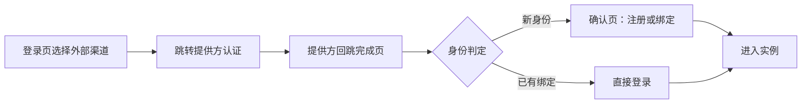

# 账号与认证

服务器模式提供完整的账号体系：本地密码登录、外部身份登录（OIDC / OAuth2）、注册策略与登录恢复。本地模式没有登录概念（自动以内置用户进入），本页内容除特别说明外均面向服务器模式。

::: tip 入口在哪
- **用户**：登录 / 注册页会按实例实际能力动态渲染可用的登录方式；绑定与解绑在 [设置中心 · 安全](/zh/guide/modes#界面上的差异)。
- **管理员**：管理员后台的「账号与认证」页集中管理注册入口、本地账号政策与外部认证连接。
:::

## 登录方式

实例可同时开放多种登录渠道，登录页只展示当前实际可用的渠道：

| 渠道 | 说明 | 由谁开启 |
| --- | --- | --- |
| 本地密码 | 用户名或已验证邮箱 + 密码；定位符（用户名 / 邮箱）与密码是否可用由本地账号政策决定 | 管理员在后台配置 |
| OIDC | 标准 OIDC 提供方（discovery + PKCE S256），如企业 IdP | 管理员在后台创建并启用 |
| 通用 OAuth2 | 兼容 OAuth2 授权码 + PKCE S256 的提供方（confidential client） | 管理员在后台创建并启用 |

内置的本地密码渠道始终存在，但是否可用于登录、注册、首次设密由本地账号政策控制（见下文）。若实例没有任何可用登录方式，登录页会提示「此实例当前没有可用的登录方式，请联系管理员」。

## 注册

注册有**总开关**与**渠道政策**两层：

1. **公开注册总开关** — 管理员后台系统设置中的 `registration_enabled`，默认关闭。关闭时注册接口返回 403，本地注册与外部渠道注册都不能创建新账号（已有账号的登录与绑定不受影响）。
2. **本地注册政策** — 属于本地账号政策的一部分：是否允许本地注册、注册邮箱是必填还是可选，以及注册准入规则（见 [认证规则](#认证规则与属性映射)）。
3. **外部渠道注册** — 由各连接的 signup 规则集约束，不符合规则的的外部身份会被拒绝注册。

注册时的字段要求：

- **用户名 + 密码**必填；密码至少 8 个字符、最多 72 字节
- **邮箱**可选（除非政策要求必填）；填写的邮箱仅作为未验证资料，不会自动成为登录定位符
- 公开注册一律创建普通用户，新账号不能自我提权

## 外部登录流程

以 OIDC / OAuth2 渠道登录或注册时：



- **外部浏览器认证** — 桌面端会拉起系统浏览器完成认证，认证结果回到 LinguaFlow 的完成页；完成页只会跳转到部署配置中登记的可信地址。
- **可选设置本地密码** — 首次通过外部身份注册时，可顺带设置一个本地密码，之后可任选渠道登录。
- **失败有明确分类** — 规则拒绝、注册已关闭、流程过期等都会得到明确的提示，不会暴露上游提供方的原始错误。

## 绑定与解绑

已登录用户可在**设置中心 · 安全**管理自己的登录方式：

- 查看当前可用的登录方式（本地密码与已绑定的外部身份）
- 绑定新的外部身份（跳转提供方认证后确认绑定）
- 解绑某个外部身份：需要提供一份**近期的重认证证明**（重新输入密码或重新走一次外部认证），且解绑后至少保留一种可用登录方式——否则会被拒绝，防止把自己锁在账号外
- 修改密码（需提供当前密码；改密后现有会话保持有效）

## 管理员：账号与认证管理台

管理员后台的「账号与认证」页（`/admin/authentication`）分三块：**公开注册**状态摘要、**本地账号政策**、**外部认证连接**。

### 本地账号政策

本地账号政策决定内置密码渠道的能力边界：

| 开关 | 说明 |
| --- | --- |
| 密码登录 | 是否允许使用密码登录 |
| 用户名定位 | 登录时是否可用用户名找到账号 |
| 邮箱定位 | 登录时是否可用已验证邮箱找到账号 |
| 首次设密 | 外部身份用户是否可以补设本地密码 |
| 本地注册 | 是否允许在注册页直接创建账号（含邮箱必填 / 可选与注册规则） |

页面会展示政策的**有效能力**（可登录 / 可注册 / 可首次设密）。保存前可先预览规则对具体注册请求的判定结果、评估政策对现有用户的影响；保存带版本号做乐观锁，冲突时会提示刷新。

::: warning 保留一条可用入口
收紧政策前先确认不会把用户（包括管理员自己）锁在外面：例如关闭密码登录前，确保相关用户都有可用的外部身份绑定；「末位管理员保护」同样适用于登录方式——管理员至少要保留一种能登录的方式。
:::

### 认证连接生命周期

每个外部认证连接（OIDC 或通用 OAuth2）有明确的状态机：`configuring`（配置中）→ `enabled`（启用）⇄ `disabled`（停用），另可 `archive` 归档（保留配置但退出服务）后 `restore` 恢复。

| 动作 | 行为 |
| --- | --- |
| 配置 | 编辑连接参数；已启用的连接会先退出服务、回到「配置中」 |
| 测试 | 用当前配置真实走一次认证；测试证据绑定当前管理员会话且有时效 |
| 启用 | 要求配置完整、规则测试通过且测试证据新鲜有效；启用后开放正式登录 |
| 停用 | 立即停止正式用途、阻断在途认证请求，并撤销依赖该连接的会话 |
| 归档 / 恢复 | 归档保留配置供日后参考；恢复后回到「配置中」重新走启用流程 |

::: warning 启用前的影响评估
启用或停用会改变用户的可用登录方式。若变更会导致某些用户**没有任何已验证的备用登录方式**（可能被锁在账号外），操作会被拒绝并返回影响评估结果——按提示先处理受影响用户再重试。
:::

连接配置要点：

- **OIDC** — 填提供方 discovery 地址与客户端凭据；默认 scopes 为 `openid profile`，要求提供方支持 PKCE S256；回跳地址仅接受 HTTPS（本机回环调试需在部署配置显式放行，见 [配置文件与环境变量](/zh/guide/configuration#server-authentication-—-外部认证)）
- **通用 OAuth2** — 填授权、令牌与用户信息端点；交换阶段必须提供 `client_secret`；通过**subject 映射**从用户信息端点提取唯一标识
- **连接测试** — 「保存配置」不等于「可用」：启用前必须完成一次真实认证测试，测试通过且未过期才能启用

### 认证规则与属性映射

每个连接可为 **login（登录）**、**signup（注册）**、**link（绑定）** 三种用途分别配置规则集：

- 规则集两种形态：`unrestricted`（不限制）或 `conditions`（条件判定，最多 64 条，支持「全部满足 / 任一满足」）
- 条件基于**属性**——外部邮箱、邮箱域名、注册邮箱等，配合等于 / 包含 / 前缀等运算符，例如「仅允许 `@example.com` 邮箱注册」
- **属性映射**可从 OIDC 令牌 / 用户信息或 OAuth2 profile 中提取最多 64 个属性供规则引用
- 管理台提供属性目录与规则预览，配置前可先模拟判定结果

本地注册政策中的「注册规则」使用同一套规则引擎。规则与属性的字段级定义见 [API 参考](/zh/api/)。

## 管理员登录恢复

当所有管理员都无法登录（密码丢失、唯一管理员账户异常）时，在**服务器所在机器**上用维护命令恢复：

```bash
# 为活跃管理员签发短期单次登录恢复凭据
linguaflow admin authentication-recovery issue --config server.yaml --username admin

# 用恢复凭据重置密码，并恢复全站密码登录、关闭本地注册
linguaflow admin authentication-recovery restore-local-login \
  --token-file ./recovery-token --password-file ./new-password

# 撤销未使用的恢复凭据
linguaflow admin authentication-recovery revoke --token-file ./recovery-token
```

命令需在部署机上直接访问数据库运行（HTTP 服务未启动时也可用）。参数与安全约束详见 [CLI 命令参考](/zh/guide/cli#admin-命令)。

## 相关配置与文档

- [配置文件与环境变量 · server.authentication](/zh/guide/configuration#server-authentication-—-外部认证) — 公网地址、可信回调地址、限流等部署侧配置
- [管理员后台](/zh/guide/admin) — 用户管理、系统设置与审计日志
- [API 参考](/zh/api/) — 认证端点速览与 OpenAPI 规范
- [CLI 命令参考](/zh/guide/cli#admin-命令) — `admin initialize` / `recover` / `authentication-recovery`
